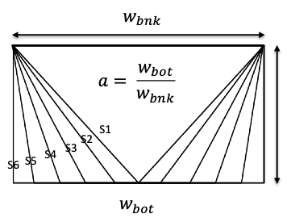
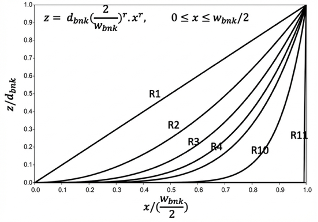
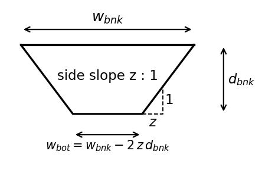

# HydroGeom

**Live at: https://conus-channel-geometry.onrender.com**

A web page, an API, and a Python package for getting
machine-learning estimates of bankfull and mean-flow channel width and depth for
**2,691,339 NHDPlusV2.1 reaches** and **28,164 USGS gages** across the
conterminous United States, and for computing cross-sectional area, wetted
perimeter, and hydraulic radius.

Instead of downloading the full 2.5 GB release, you can get just the reaches or
gages you need, selected by ID, state, HUC2, HUC8, or an area on a map, as CSV,
GeoJSON, or a zipped shapefile, or straight into pandas or GeoPandas.

The models and the dataset come from the
[Bankfull-and-mean-flow-channel-geometry-for-CONUS](https://github.com/Reizrb/Bankfull-and-mean-flow-channel-geometry-for-CONUS)
repository.

| Component | Folder | What it does |
|-----------|--------|--------------|
| **HydroGeomSite** | [`hydrogeomsite/`](hydrogeomsite) | The web page: pick an area on a map and download |
| **HydroGeomAPI** | [`hydrogeomapi/`](hydrogeomapi) | The API that serves the data |
| **HydroGeomKit** | [`hydrogeomkit/`](hydrogeomkit) | The Python package: get the data and compute channel hydraulics |

**Contents:** [Web page](#using-the-web-page) ·
[What you get](#what-you-get) ·
[Python package](#using-the-python-package-hydrogeomkit) ·
[API](#using-the-api-from-code) ·
[Cite](#how-to-cite) ·
[How it works](#how-it-works) ·
[Run it yourself](#running-it-on-your-own-computer)

## Using the web page

Open https://conus-channel-geometry.onrender.com and:

1. Choose **River reaches** or **USGS gages**.
2. Choose where: a HUC8 watershed, a state, a HUC2 region, a list of IDs, an area
   you draw on the map, a shapefile you upload, or all of CONUS (gages only).
3. Choose a format and click **Download data**.
4. Click **Show these on the map** to see the results. Click a reach or gage for
   its width and depth.

The map offers USGS shaded relief with the NHD river network, OpenTopoMap, and
satellite imagery, and the page has light and dark themes.

## What you get

| Column      | Description        | Units |
|-------------|--------------------|-------|
| `bnk_width` | Bankfull width     | m     |
| `bnk_depth` | Bankfull depth     | m     |
| `mf_width`  | Mean-flow width    | m     |
| `mf_depth`  | Mean-flow depth    | m     |

**Reaches** also include `comid`, `reachcode`, `state`, `huc2`, `huc8`,
`stream_order`, and `tot_da_sqkm` (total drainage area, km²).
**Gages** also include `site_no`, `station_nm`, `comid` (the reach the gage is on),
`reachcode`, `state`, `huc2`, `huc8`, `da_sqkm` (drainage area, km²), `lat`, and `lon`.

### Formats and limits

| Format    | Contents                                  | Records per download |
|-----------|-------------------------------------------|----------------------|
| CSV       | Values only, no line shapes               | up to 500,000        |
| GeoJSON   | Values plus reach lines or gage points    | up to 50,000         |
| Shapefile | Values plus reach lines or gage points (zipped) | up to 50,000   |

A CSV covers any single state or HUC2 region. For all of CONUS, download the full
dataset from [Zenodo](https://doi.org/10.5281/zenodo.19208847).

### Good to know

- **Missing predictions:** reaches and gages without a prediction are still
  returned, with empty width and depth values, so every ID you ask for comes back.
- **Leading zeros:** HUC codes, reach codes, and USGS site numbers keep their
  leading zeros (for example `03160112`). Excel drops them when it opens a CSV, so
  import those columns as text, or read the file with Python or R.
- **Coordinate system:** geometries are in NAD83 (EPSG:4269), the NHDPlusV2.1
  system. Drawn polygons and uploaded shapefiles in any coordinate system are
  converted automatically.
- **Shapefile column names** are limited to 10 characters, so `stream_order`
  becomes `stream_ord` and `tot_da_sqkm` becomes `tot_da_sqk`. CSV and GeoJSON
  keep the full names.
- **Speed:** the service currently runs on a small free server. Most requests take
  a few seconds, and a whole state or HUC2 region can take a minute or more.

## Using the Python package (HydroGeomKit)

**HydroGeomKit** (`hydrogeomkit`) gets the data straight into pandas or GeoPandas
through the API, so there's nothing to download or unzip first. It also computes
cross-section hydraulics for any widths and depths.

### Install

```bash
pip install "git+https://github.com/Reizrb/HydroGeom"
```

To get reach lines and gage points as a GeoDataFrame, also install GeoPandas:

```bash
pip install geopandas
```

### Get channel width and depth

```python
from hydrogeomkit import get_channel_geometry

# All reaches in a HUC8 watershed, as a pandas table
reaches = get_channel_geometry(huc8="03160112")

# Specific reaches by COMID
reaches = get_channel_geometry(comids=[18223451, 721640])

# A whole state or HUC2 region (values only, up to 500,000 reaches)
alabama = get_channel_geometry(state="AL")

# USGS gages, by site number (as text, to keep leading zeros)
gages = get_channel_geometry(site_nos=["02465000", "01206900"])

# Gages in a state, with their points, as a GeoDataFrame
gages = get_channel_geometry(dataset="gage", state="AL", geometry=True)

# Reaches inside your own study area (a shapely geometry, or a GeoDataFrame in any CRS)
import geopandas as gpd
basin = gpd.read_file("my_basin.shp")
reaches = get_channel_geometry(polygon=basin, geometry=True)
```

Choose **one** way to select the area: `comids`, `site_nos`, `state`, `huc2`,
`huc8`, `polygon`, or `conus=True` (gages only). The columns are the same as in
[What you get](#what-you-get). Codes are kept as text, and records without a
prediction have empty (NaN) width and depth.

| `geometry=`     | Returns                              | Records per call |
|-----------------|--------------------------------------|------------------|
| `False` (default) | pandas DataFrame, values only      | up to 500,000    |
| `True`          | GeoDataFrame with lines or points (EPSG:4269) | up to 50,000 |

### Compute hydraulic geometry

Three functions compute the cross-section geometry of a channel from its top width
and depth, for a chosen channel shape:

| Function | Returns | Units |
|----------|---------|-------|
| `xsec_area` | Cross-sectional area | m² |
| `wetted_perimeter` | Wetted perimeter | m |
| `hydraulic_radius` | Hydraulic radius (area / wetted perimeter) | m |

```python
from hydrogeomkit import get_channel_geometry, xsec_area, wetted_perimeter, hydraulic_radius

df = get_channel_geometry(huc8="03160112")

# Dingman's r (bank curvature)
df["bnk_xsce_A"] = xsec_area(df["bnk_width"], df["bnk_depth"], shape="r", r=2)
df["bnk_wet_p"] = wetted_perimeter(df["bnk_width"], df["bnk_depth"], shape="r", r=2)
df["bnk_hyd_R"] = hydraulic_radius(df["bnk_width"], df["bnk_depth"], shape="r", r=2)

# Bottom-to-top width ratio a, with a different value for each reach
df["mf_xsce_A"] = xsec_area(df["mf_width"], df["mf_depth"], shape="a", a=df["a"])

# Side slope z:1
df["bnk_wet_p_z"] = wetted_perimeter(df["bnk_width"], df["bnk_depth"], shape="z", z=2)

# Single values
A = xsec_area(width=18.19, depth=1.23, shape="r", r=2)
```

#### Channel shape parameters

Each function takes the top width (`width`, w<sub>bnk</sub>) and depth (`depth`,
d<sub>bnk</sub>), plus one shape parameter. All three shapes assume a **symmetric
channel**: both banks have the same shape and slope, and the deepest point is at the
center of the channel.

<table>
<tr>
<td align="center"><br><b>(a)</b> <code>shape="a"</code><br><sub>Zarrabi et al. (2026)</sub></td>
<td align="center"><br><b>(b)</b> <code>shape="r"</code><br><sub>Dingman &amp; Afshari (2018)</sub></td>
<td align="center"><br><b>(c)</b> <code>shape="z"</code></td>
</tr>
</table>

- **`a`, bottom-to-top width ratio** (panel a; Zarrabi et al., 2026): the bottom width
  divided by the top width, from 0 to 1. `a = 0` is a triangular channel, `a = 1` a
  rectangular channel, and values in between are trapezoids.
- **`r`, Dingman's shape parameter** (panel b; Dingman & Afshari, 2018): defines the
  curvature of the banks. `r = 1` is triangular, `r = 2` parabolic, and higher values
  approach rectangular. `r` must be at least 1.
- **`z`, side slope** (panel c): banks with a slope of `z` horizontal to 1 vertical
  (`z:1`). `z = 0` is rectangular. The banks must fit inside the top width; rows where
  they don't get an empty result, with a warning.

Widths and depths are in meters.

#### Inputs and outputs

- `width`, `depth`, and the shape parameter (`r`, `a`, or `z`) can each be a single
  number, a list, an array, or a pandas column, so the shape parameter can change
  from row to row.
- A pandas column in gives a pandas column out, with the same index, so results can be
  added straight to your table. A single number in gives a single number out.
- Missing, zero, or negative widths or depths, or a missing shape parameter, give an
  empty (NaN) result for that row only.
- `r` below 1, `a` outside 0 to 1, or a negative `z` stops with an error.
- The functions work on any widths and depths, not only data from the API, and need no
  internet connection.

### Package errors and options

- `TooManyRecords`: the area is too big for one call. It has `.records` and
  `.limit`. Use `geometry=False`, or a smaller area.
- `ChannelGeometryError`: anything else, with the reason from the API.
- The package waits and retries automatically if the server is starting up, and
  waits up to 10 minutes for large areas (set `timeout=` to change this).
- `status()` shows how many reaches and gages are available.
- `base_url=` (or the `HYDROGEOMKIT_URL` environment variable) points the package
  at another copy of the API.

## Using the API from code

Send a `POST` request to `/extract` with a JSON body:

| Field          | Values                                                  |
|----------------|---------------------------------------------------------|
| `dataset`      | `reach` (default) or `gage`                             |
| `request_type` | `ids`, `state`, `huc2`, `huc8`, `polygon`, or `conus`   |
| `format`       | `csv` (default), `geojson`, or `shapefile`              |

Add the value for your request type: `ids` (a list of COMIDs for reaches, or USGS
site numbers for gages, written as text so leading zeros are kept, such as `"02465000"`), `state` (such as `"AL"`), `huc2` (such as `"03"`), `huc8`
(such as `"03160112"`), or `polygon` (a GeoJSON geometry in longitude/latitude).

### Python

```python
import io
import pandas as pd
import requests

API = "https://conus-channel-geometry.onrender.com/extract"

# All reaches in one HUC8, as a table
r = requests.post(API, json={"request_type": "huc8", "huc8": "03160112", "format": "csv"})
r.raise_for_status()
reaches = pd.read_csv(io.StringIO(r.text), dtype={"reachcode": str, "huc2": str, "huc8": str})

# Specific reaches by COMID
r = requests.post(API, json={"request_type": "ids", "ids": [18223451, 721640]})
by_comid = pd.read_csv(io.StringIO(r.text))

# USGS gages in a state, with their points, as GeoJSON
import geopandas as gpd
r = requests.post(API, json={"dataset": "gage", "request_type": "state",
                             "state": "AL", "format": "geojson"})
gages = gpd.read_file(io.BytesIO(r.content))
```

### R

```r
library(httr2)
library(readr)

api <- "https://conus-channel-geometry.onrender.com/extract"

resp <- request(api) |>
  req_body_json(list(request_type = "huc8", huc8 = "03160112", format = "csv")) |>
  req_perform()

reaches <- read_csv(resp_body_string(resp),
                    col_types = cols(reachcode = "c", huc2 = "c", huc8 = "c"))
```

### Command line

```bash
curl -X POST https://conus-channel-geometry.onrender.com/extract \
  -H "Content-Type: application/json" \
  -d '{"request_type": "huc8", "huc8": "03160112", "format": "shapefile"}' \
  -o reaches.zip
```

### Uploading a polygon shapefile

Send a zipped shapefile (with its `.prj` file) to `POST /extract/shapefile` as a
form upload, with `format` and `dataset` as form fields:

```bash
curl -X POST https://conus-channel-geometry.onrender.com/extract/shapefile \
  -F "file=@my_area.zip" -F "format=csv" -F "dataset=reach" -o reaches.csv
```

### Other endpoints

| Endpoint  | What it returns                                            |
|-----------|------------------------------------------------------------|
| `/docs`   | Interactive API documentation, where you can try requests  |
| `/status` | API version, number of reaches and gages available, and the data source |
| `/health` | A quick check that the service is running                  |

### Errors

| Code | Meaning |
|------|---------|
| 400  | Something is missing or not valid, such as a HUC8 that isn't 8 digits |
| 404  | Nothing matched the request |
| 413  | Too many records for the chosen format. The message suggests CSV or a smaller area |

## How to cite

If you use this data, please cite the paper and the dataset:

- Zarrabi, R., McDermott, R., Erfani, S. M. H., & Cohen, S. (2025). Bankfull and
  mean-flow channel geometry estimation through machine learning algorithms across
  the CONtiguous United States (CONUS). *Water Resources Research*, 61(2).
  https://doi.org/10.1029/2024WR037997
- Dataset (latest version): [Zenodo](https://zenodo.org/records/19208847)
  (doi:10.5281/zenodo.19208847) and
  [HydroShare](https://www.hydroshare.org/resource/1a2e115c212f4f4a80660f94339205e6/),
  CC-BY-4.0

If you use the channel shape parameters, please also cite:

- Dingman, S. L., & Afshari, S. (2018). Field verification of analytical at-a-station
  hydraulic-geometry relations. *Journal of Hydrology*.
- Zarrabi, R., Cohen, S., Pruitt, C., Baruah, A., McDermott, R., & Chen, Y. (2026).
  Sensitivity of terrain-based flood inundation model (OWP HAND-FIM) predictions to
  channel geometry: Insights from bathymetric adjustments of rating curves and stage
  shift. *Journal of Hydrology*.

## How it works

The API is a Python [FastAPI](https://fastapi.tiangolo.com/) application. The data
is stored as two GeoParquet files (`reaches.parquet` and `gages.parquet`) in a
[Hugging Face dataset](https://huggingface.co/datasets/Reizrb/bankfull-meanflow-conus).
[DuckDB](https://duckdb.org/) reads only the parts of those files that a request
needs, and writes the CSV, GeoJSON, or shapefile directly, so large downloads use
little memory. The files are sorted by HUC8, which keeps regional requests fast.
The web page uses [Leaflet](https://leafletjs.com/) with basemaps from USGS The
National Map, OpenTopoMap, and Esri.

The service is packaged as a Docker container (see the `Dockerfile`) and currently runs on
[Render](https://render.com/). To point it at another storage location (such as
an S3 bucket), set the `CG_DATA_URL` environment variable to the folder that holds
the two Parquet files.

The Docker container holds HydroGeomAPI and HydroGeomSite. HydroGeomKit is a separate
client: it calls the same API over the internet and is not part of the container.

## Running it on your own computer

```bash
cd hydrogeomapi
python -m venv venv
source venv/bin/activate
pip install -r requirements.txt
uvicorn app:app --reload
```

Then open http://127.0.0.1:8000. Without local data files, the API reads the data
from Hugging Face automatically.

To build the data files yourself, download the reach shapefile and gage CSV from
the latest Zenodo record, plus the
[Census state boundaries](https://www2.census.gov/geo/tiger/GENZ2023/shp/cb_2023_us_state_500k.zip),
into the `hydrogeomapi/` folder, then run from there (the reach build takes 10–30 minutes):

```bash
python prepare_data.py gage
python prepare_data.py reach
```

To check that everything works:

```bash
cd hydrogeomapi && python test_api.py                        # the API
cd .. && pip install -e . pytest && python -m pytest hydrogeomkit/tests  # the Python package
```

To try the API without the real data, `python make_sample_data.py` builds a small
fake reach file (run it inside `hydrogeomapi/`).

## Files

| File                         | Purpose                                                        |
|------------------------------|----------------------------------------------------------------|
| `hydrogeomsite/`             | HydroGeomSite: the web page (`index.html`, `about.html`) and logo |
| `hydrogeomapi/app.py`        | HydroGeomAPI: the API                                          |
| `hydrogeomapi/prepare_data.py` | Builds `reaches.parquet` and `gages.parquet`, sorted by HUC8 |
| `hydrogeomapi/make_sample_data.py` | Builds a small fake reach file for testing             |
| `hydrogeomapi/test_api.py`   | Checks every request type                                      |
| `hydrogeomapi/requirements.txt` | Python packages the API needs                               |
| `hydrogeomkit/`              | HydroGeomKit: the Python package, with its tests in `tests/`   |
| `pyproject.toml`             | Package settings used by `pip install`                         |
| `Dockerfile`                 | Builds the container (API + web page) used for hosting         |
| `assets/`                    | Images used in this README                                     |

## License

Code: [MIT](LICENSE). Data: CC-BY-4.0 (see the Zenodo record).

## Related repositories

| Repository | What it does |
|------------|--------------|
| [Bankfull-and-mean-flow-channel-geometry-for-CONUS](https://github.com/Reizrb/Bankfull-and-mean-flow-channel-geometry-for-CONUS) | The research: model development, evaluation, and the dataset |
| [HydroGeom](https://github.com/Reizrb/HydroGeom) | This repository: HydroGeomSite, HydroGeomAPI, and HydroGeomKit |
